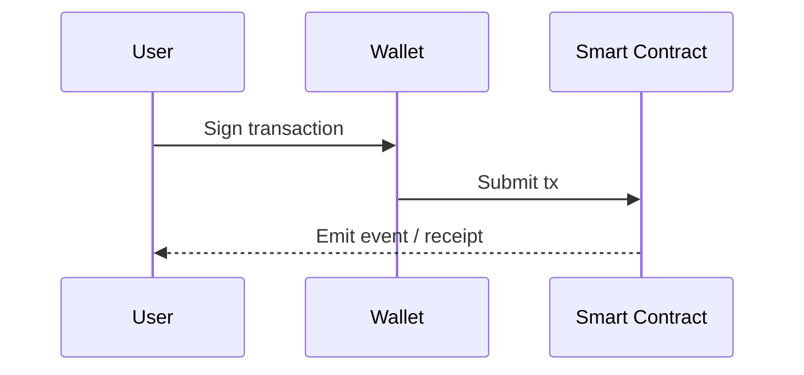

## Mermaid diagrams

Write diagrams as code in a `mermaid` block:



## Live code blocks

Add `live` to a `jsx` block to get an editable playground:

```jsx live
function Counter() {
  const [count, setCount] = React.useState(0);
  return (
    <button className="button button--primary" onClick={() => setCount(count + 1)}>
      Clicked {count} times
    </button>
  );
}
```

## Highlighted lines

Use magic comments to call out lines:

```js title="auth.js"
const token = getToken();
// error-next-line
if (token == null) throw new Error('Missing token');
// success-next-line
return verify(token);
```
